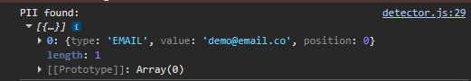
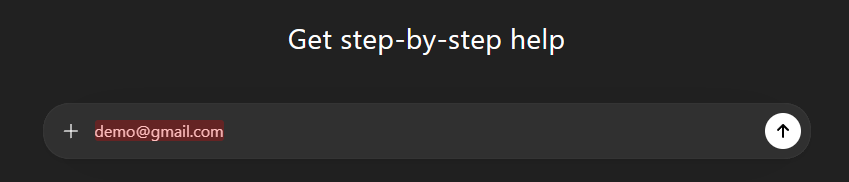

# Group 14 - Cybersecurity

## Description

This is a prototype of our endpoint data-loss-prevention (DLP) tool that automatically detects sensitive information such as PII or confidential data (API keys, Financial data, Auth tokens, etc.) in AI prompts to prevent their accidental exposure to the cloud. Our detector uses regex and quantized locally hosted NER models so that no data ever leaves your machine.

## Repository Structure

`chrome_extension/` contains all source code for the chrome extension along with a `README.md` file that explain the code's structure, functionality and useful development resources.

`docs/` contains more of the project's documentation including **flowcharts** for the horizontal slice, a **demo video** of our prototype, and **UI mockups**.

```
group-14-cybersecurity
├─ chrome_extension # Main Chrome Extension 
│  ├─ background.js
│  ├─ content
│  ├─ images
│  ├─ lib
│  ├─ manifest.json
│  ├─ quantize.py
│  ├─ README.md
├─ docs # Project's documentation
│  ├─ flowcharts
│  ├─ media
│  └─ README.md # docs 
├─ LICENSE
├─ README.md
└─ requirements.txt
```

## PROTOTYPE INSTALLATION GUIDE

### Installation Guide
1. Run `python -m venv .venv` to create local virtual environment
2. Execute `.venv/scripts/Activate.ps1` to activate the virtual environment
3. Execute `pip install -r requirements.txt` to install all required python libraries

1. Run quantization script with `python chrome_extension/quantize.py` while in repo's root. !!! decide if needed before submission.
2. The quantized models will now appear under `chrome_extension_models/`

### Extension setup 
1. Launch Google Chrome
2. Click 3 dots on the top right
3. Navigate through `Extensions` -> `Manage Extensions` 

4. Select `Load Unpacked` on the top left
5. Navigate through `path/to/repo` and select the `chrome_extension` folder
6. Your extension is now loaded and running

### Backend Demo
1. Navigate to an LLM website that is included in `manifest.json`'s permitted hosts.
    - [ChatGPT](https://www.chatgpt.com/)
    - [Claude](https://claude.ai/)
    - [Gemini](https://gemini.google.com)
    - [Perplexity](https://www.perplexity.ai/)
2. Press `F12` to enable the Developer Tools
3. Type any `PII` into a text-box and inspect the `console` on the top right.

4. The sensitive data is also highlighted in red. \

5. A warning overlay should be visible on the top right. \

## Future Work

### Horizontal Slice Goals
1. UI Mockup in `docs/ui`
2. User interaction flowchart in `docs/flowcharts/user_interaction/`
3. System's component interaction flowchart in `docs/flowcharts/system/`
4. Proper documentation of project's structure

### Vertical Slice Goals
1. Proper documentation of chosen approaches, such as:
    - Browser Extensions
    - Datasets
    - Quantization
    - ONNX Runtime
    - NER models
    - Regex
2. Functioning highlighting system.
3. Functioning overlay system.
4. Functioning sensitive data detection using regex + NER.

### Future Goals
1. Allow user to rephrase/redact text once prompted with a popup.
2. Work on a Firefox extension to support more browsers.
3. Further optimize NER implemntation to be less computationally expensive.
4. Fine-tune NER model on privacy focused data to increase accuracy.
5. UI adjustments to make it more user-friendly and less intrusive.
