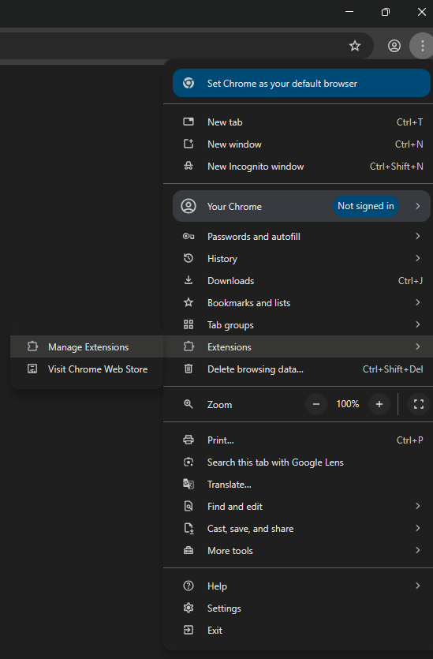

# Group 14 - Cybersecurity

## PROTOTYPE INSTALLATION GUIDE

### Installation Guide
1. Run `python -m venv .venv` to create local virtual environment
2. Execute `.venv/scripts/Activate.ps1` to activate the virtual environment
3. Execute `pip install -r requirements.txt` to install all required python libraries

1. Run quantization script with `python chrome_extension/quantize.py` while in repo's root
2. The quantized models will now appear under `chrome_extension_models/`

### Extension setup 
1. Launch Google Chrome
2. Click 3 dots on the top right
3. Navigate through `Extensions` -> `Manage Extensions` 

4. Select `Load Unpacked` on the top left
5. Navigate through `path/to/repo` and select the `chrome_extension` folder
6. Your extension is now loaded and running

### Backend Demo
1. Navigate to an LLM website that is included in `manifest.json`'s permitted hosts.
    - [ChatGPT](https://www.chatgpt.com/)
    - [Claude](https://claude.ai/)
    - [Gemini](https://gemini.google.com)
    - [Perplexity](https://www.perplexity.ai/)
2. Press `F12` to enable the Developer Tools
3. Type any `PII` into a text-box and inspect the `console` on the top right.

### Future Goals