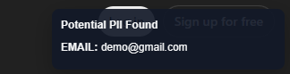

# Group 14 - Cybersecurity

## Description

This is a prototype of our endpoint data-loss-prevention (DLP) tool that automatically detects sensitive information such as PII or confidential data (API keys, Financial data, Auth tokens, etc.) in AI prompts to prevent their accidental exposure to the cloud. Our detector uses regex and quantized locally hosted NER models so that no data ever leaves your machine.

## Repository Structure

`chrome_extension/` contains all source code for the chrome extension along with a `README.md` file that explain the code's structure, functionality and useful development resources.

`docs/` contains more of the project's documentation including **flowcharts** for the horizontal slice, a **demo video** of our prototype, and **UI mockups**.

```
group-14-cybersecurity
├─ chrome_extension # Main Chrome Extension 
│  ├─ src/ # Extension's source code
│  ├─ manifest.json # Extension's config
│  ├─ quantize.py
│  ├─ README.md # Further code structure documentation
├─ docs # Project's documentation files
│  ├─ flowcharts
│  ├─ media
│  └─ README.md # docs/ Structure documentation
├─ LICENSE # GPL Open Source License
├─ README.md
└─ requirements.txt # Python requirements
```

## PROTOTYPE INSTALLATION GUIDE

### Virtual environment setup
1. Run `python -m venv .venv` to create local virtual environment
2. Execute script activation command to activate the virtual environment
  - Windows: `.venv/scripts/Activate.ps1`
  - Linux/MacOS: `source .venv/bin/activate` 
3. Execute `pip install -r requirements.txt` to install all required python libraries

### GLiNER Server setup
Ensure virtual environment is activated and required libraries are installed.
```
curl -X POST http://127.0.0.1:8000 \
    -H "Content-Type: application/json" \
    -d '{"text": "Cristiano Ronaldo was born in 1985 and plays for Al Nassr", "labels": ["Person", "Date", "Teams"]}'
```
### Accesing fine tuned model
Due to the that the model size is too big , the following google drive link gives access to the checkpoint of the model:
link: https://drive.google.com/drive/folders/1Qg3sUyRwqMGFAQYz1vP6WFpAkGiimmcu?usp=sharing


### Quantized Model Installation Guide - Not integrated in prototype - Currently Redundant!

1. Run quantization script with `python chrome_extension/quantize.py` while in repo's root. | Possibly redundant!
2. The quantized models will now appear under `chrome_extension_models/`. | Possibly redundant !

### Extension setup 
1. Launch Google Chrome
2. Click 3 dots on the top right
3. Visit `chrome://extensions/`
4. Turn on developer mode and select `Load Unpacked` on the top left
5. Navigate through `path/to/repo` and select the `chrome_extension` folder
6. Your extension is now loaded and running

### Backend Demo
1. Navigate to an LLM website that is included in `manifest.json`'s permitted hosts.
    - [ChatGPT](https://www.chatgpt.com/)
    - [Claude](https://claude.ai/)
    - [Gemini](https://gemini.google.com)
    - [Perplexity](https://www.perplexity.ai/)
2. Press `F12` to enable the Developer Tools
3. Type any `PII` into a text-box and inspect the `console` on the top right.
 


4. The sensitive data is also highlighted in red.


5. A warning overlay should be visible on the top right.  



## Future Work

### Horizontal Slice Goals
1. UI Mockup in `docs/ui`
2. User interaction flowchart in `docs/flowcharts/user_interaction/`
3. System's component interaction flowchart in `docs/flowcharts/system/`
4. Proper documentation of project's structure and goals

### Vertical Slice Goals
1. Proper documentation of chosen approaches, such as:
    - Browser Extensions
    - Datasets
    - Quantization
    - NER models
    - Regex
2. Functioning highlighting system.
3. Functioning overlay system.
4. Functioning sensitive data detection using regex.
5. Auditable open-source code with GLP license.

### Future Goals
1. Allow user to **rephrase/redact** text once prompted with a popup.
2. Work on a **Firefox** extension to support more browsers.
3. Integrate quantized **ONNX** model in `detector.js`.
4. Further optimize **NER** implemntation to be less computationally expensive.
5. Fine-tune **NER** model on privacy focused data to increase accuracy.
6. UI adjustments to make it more aesthetically pleasing and robust across websites.
7. Extend rule-based detection cases to cover a wider range of scenarios.
8. Utilize a **debounce** timer to improve performance on larger text.
9. Utilize `background.js` and `workers` to improve performance and perform expensive computations without slowing down the front end.
10. Improve event handling, to handle pasted text, new lines, and deletions more gracefully.
