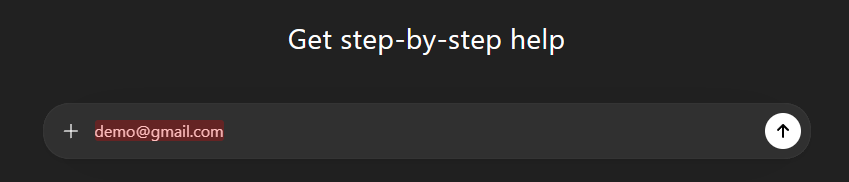
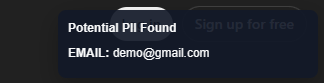

## Code Structure

```
├─ chrome_extension
│  ├─ background.js
│  ├─ content
│  │  ├─ content.js
│  │  ├─ highlight.js
│  │  └─ overlay.js
│  ├─ images
│  ├─ lib
│  │  └─ detector.js
│  ├─ manifest.json
│  ├─ quantize.py
│  ├─ README.md
│  └─ styles
│     ├─ highlight.css
│     ├─ overlay.css
│     └─ popup.css
```
- `content.js` is responsible for event handling, which is currently limited to user input.
- `highlight.js` handles all highlighting logic of detected sensitive information.

- `overlay.js` handles the logic of the warning overlay when sensitive informatio is detected.

## Useful development resources

1. [HuggingFace](https://huggingface.co/)
2. [Optimum-ONNX](https://huggingface.co/docs/optimum-onnx/onnxruntime/overview)
3. [Bert-Base-NER](https://huggingface.co/dslim/bert-base-NER)
4. [Chrome Extension Docs](https://developer.chrome.com/docs/extensions/)